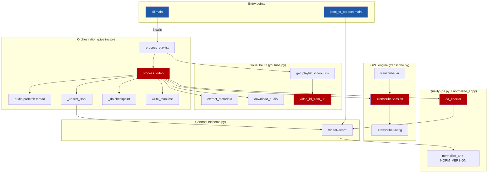

# Code Intelligence

Multi-layered code intelligence for `transcribe-engine`, powered by
codebase-memory-mcp (structural graph), graphify (AST graph + communities)
and repomix (context packing). Built for the current tree including the
uncommitted hardening pass (`qa.py`, `TranscribeSession`, manifest, prefetch).

## Status

| Layer | Status | Details |
|-------|--------|---------|
| **Structural Graph** | ✅ Indexed | `D-AI-Projects-transcribe-engine`, 407 nodes, 1,437 edges, 0 parse errors |
| **PR Review Graph** | ✅ Built | code-review-graph full build: 93 nodes, 795 edges, at `6261e8f` |
| **Multimodal Graph** | ✅ Built (code-only) | `graphify-out/graph.json`: 276 nodes, 489 edges, 14 communities |
| **Context Pack** | ✅ Ready | repomix outputId `98621a358edc4806`, 25 files, 14,023 tokens (markdown, compressed) |
| **Watcher** | Auto-refresh | Watched index; rebuilt incrementally on git changes |

Graphify was extracted with `--code-only` (no LLM API keys configured on this
machine), so doc files are indexed by pathlib counts, not semantic edges.
Re-run `graphify extract . ` (without `--code-only`) once a key (Gemini/
Claude/OpenAI) is exported for code↔docs cross-references.

## Architecture



Blue = entry points, red = graph hotspots. Edge counts come from measured
codebase-memory boundaries, not guesswork.

## Modules (from boundary data)

| Module | Role | Notable facts |
|---|---|---|
| `src/cli.py` | Entry | `video` / `playlist` subcommands, engine knobs, `--max-videos` |
| `src/pipeline.py` | Core | fan-in 12 / fan-out 8; owns checkpoint, upsert, timings, manifest, prefetch |
| `src/transcribe.py` | Core | `TranscribeSession.open` fan-in 11; fp16/CUDA, OOM fallback |
| `src/qa.py` | Core | fan-in 6, no outbound; flags-only QA |
| `src/youtube.py` | IO/API | metadata + wav; `video_id_from_url` fan-in 6 |
| `src/schema.py` | Leaf | `VideoRecord` JSONL contract |
| `src/normalize_ar.py` | Leaf | versioned Arabic fold (`NORM_VERSION`) |
| `src/jsonl_to_parquet.py` | Leaf + entry | `coerce_rows`, empty-input safe |
| `tests/` | Entry | 11 files, 83 tests; boundaries: pipeline 9, qa 6, youtube 6 calls |

## Docs ↔ code map (manual, until semantic extraction)

| Doc | Covers |
|---|---|
| `docs/ARCHITECTURE.md` | module map, VRAM budget (`TranscribeSession`, fp16) |
| `docs/PLAN_V1_V2.md` | locked scope, branch log per feature (matches `git merge` history) |
| `docs/DECISIONS.md` | 8 ADRs incl. decisions every flagged function implements |
| `docs/CURRENT-STATE.md` | proven numbers (112 segs / 44s ASR), soak results |
| `docs/ROADMAP.md` | ordered next steps |
| `docs/experiments/wer-spotcheck-01.md` | QA evidence for `qa_checks` suite limits |

## Quick Reference

| Question | Tool call |
|----------|----------|
| Who calls X? | `codebase-memory-mcp trace_path(direction="inbound")` |
| What does X call? | `codebase-memory-mcp trace_path(direction="outbound")` |
| Find by pattern | `codebase-memory-mcp search_graph(name_pattern="...")` |
| Architecture | `codebase-memory-mcp get_architecture(project=..., aspects=["all"])` |
| Uncommitted blast radius | `codebase-memory-mcp detect_changes(base_branch="main")` or `code-review-graph detect_changes(scope="impact")` |
| God nodes | `graphify_god_nodes()` (top: `process_video` 16, `TranscribeSession` 14) |
| Graph BFS Q&A | `graphify_query_graph(question="...")` |
| Shortest path | `graphify_shortest_path(from="...", to="...")` |
| Pack for LLM | `repomix_pack_codebase(directory=..., compress=true)` |

## How to re-index

```powershell
# structural graph (watched; usually automatic)
codebase-memory-mcp index_repository --project D-AI-Projects-transcribe-engine --repo_path D:/AI/Projects/transcribe-engine --mode full

# graphify graph (code-only, no API key needs) — run from repo root
graphify extract . --code-only
# re-cluster + rename communities afterwards:
graphify cluster-only .
```

## Agent tiers

| Tier | When to use | Tools |
|------|-------------|-------|
| **Scout** | Quick lookup, provisional | 7 graph + 6 repomix tools |
| **Verify** | Task-directed evidence | 15 graph + 10 graphify + coverage checks |
| **Auditor** | Full bounded verification | All 75+ tools |
