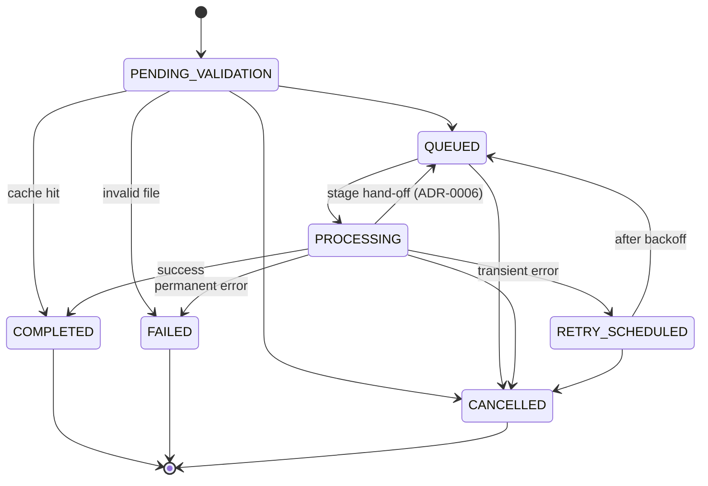

# وثيقة تصميم منصة التفريغ الصوتي العربي — الإصدار المعدل

Nov 24, 2026 · @Mohamed Kandil

## الملخص والتوصية

نبني **منصة تفريغ صوتي دفعية (Batch) غير متزامنة** للعربية، بمعمارية Clean Architecture. يكون PostgreSQL مصدر الحقيقة **والطابور معًا**، ومحرك الـ ASR وبقية مراحل الذكاء (VAD، Alignment، Diarization) معزولة خلف Ports بعقود صريحة تعلن قدرات كل محرك.

الوعد الصحيح ليس "تبديل المحرك دون تعديل حرف"، بل: **تبديل المحرك دون تعديل كود الـ Domain أو الـ API**، مع نسخة جديدة من النص (`transcript_version`) وإعادة فهرسة للـ RAG عند التبديل.

### ما تغيّر عن الإصدار الأول

| البند | الإصدار الأول | الإصدار المعدل |
| --- | --- | --- |
| مفتاح الـ Idempotency | SHA-256 للملف فقط | Hash الملف + إعدادات الـ Pipeline، مع UNIQUE constraint ونطاق لكل Tenant |
| الطابور | Redis + Celery | Postgres (`FOR UPDATE SKIP LOCKED`) في الإصدار الأول، لإلغاء مشكلة الـ Dual-write |
| الاعتمادية | `acks_late` + DLQ | Lease + Heartbeat + `attempt_count` في DB + Reconciler + Fencing |
| آلة الحالات | 4 حالات | 7 حالات + `stage` + تحذيرات للإنجاز الجزئي |
| عقد الـ ASR | Adapter عام | `ASRCapabilities` صريحة، وPorts منفصلة لـ VAD/Aligner/Diarizer/Normalizer |
| CohereX | Adapter للـ ASR | يُستبدل بـ `CohereTranscribeAdapter` مباشر (CohereX Pipeline كامل يكرر مراحلنا) |
| اختيار النموذج | المرحلة الرابعة | **المرحلة صفر**، قبل أي Infrastructure |
| الرفع | عبر الـ API | Presigned URL مباشرة إلى S3 |
| الأمان | فحص MIME وTimeout | Auth، ملكية الموارد، Sandbox لـ FFmpeg، حد للمدة، Retention وحذف |
| تشغيل النموذج | Celery Worker يحمّل النموذج بنفسه، concurrency=1 لكل GPU | vLLM كخدمة منفصلة بـ Continuous batching ودقة BF16، وأجزاء الملف تُرسل بالتوازي |
| النماذج المرشحة | Audar وCohereX وfaster-whisper | Audar وCohere Transcribe Arabic، وWhisper للمقارنة فقط؛ Falcon-ASR يُراقب حتى تُنشر أوزانه |
| تحليل الصوت | لا يوجد | Profiling لكل جزء وتوجيه حسب الحالة؛ إزالة الضوضاء وفصل الموسيقى انتقائيان لا شاملان |
| التقسيم والتجميع | مقاطع VAD أقل من 30 ثانية | تقسيم عند الصمت بتوقيت بالعينات ومعرّف ثابت، توازٍ محدود، تجميع بالـ idx وقاعدة منتصف الكلمة |
| النواتج | نص خام ومطبّع وSegments | JSON مرجعي واحد تُشتق منه كل الصيغ، ترجمات بقواعد RTL، RAG هرمي ببحث هجين واستشهاد بالتوقيت |

## النطاق والأهداف

الإصدار الأول يفرّغ ملفات صوت وفيديو عربية (العامية المصرية أولًا) حتى 3 ساعات للملف، ويُنتج نصًا بتوقيتات على مستوى الكلمة جاهزًا للـ Subtitles وللـ RAG.

### الأهداف

- دقة مقاسة بالأرقام على صوتنا الحقيقي، لا على الـ Leaderboards.
- عدم ضياع أي مهمة، وعدم معالجة نفس الطلب مرتين على GPU.
- تبديل محرك الـ ASR بـ Adapter جديد وإعداد فقط.
- نص مزدوج: `raw_text` للعرض، و`search_text` مطبّع للاسترجاع، مع خريطة إزاحات بينهما.
- عزل بيانات كل عميل (Tenant) وحذفها عند الطلب.

### خارج النطاق في الإصدار الأول

- Streaming أو WebSocket أو تفريغ لحظي.
- Kubernetes وMicroservices: خدمة API واحدة ونوعان من الـ Workers.
- الترجمة والتلخيص.
- Fine-tuning للنماذج (لاحقًا، بعد تجميع بيانات تقييم كافية).

### حدود التشغيل المبدئية

| الحد | القيمة المبدئية |
| --- | --- |
| أقصى مدة للملف | 3 ساعات (تُفحص بـ ffprobe) |
| أقصى حجم للملف | 4 GB |
| أقصى عدد محاولات | 3 |
| الاحتفاظ بالصوت الأصلي | 30 يومًا (قابل للضبط لكل Tenant) |

سؤال مفتوح: هذه القيم افتراضات، تُراجع بعد قياس الـ RTF في المرحلة صفر.

## الرؤية المعمارية

النظام يفصل المنطق **الحتمي** (التحقق، الـ Hash، الحالات، الصلاحيات، إعادة المحاولة) عن المكونات **الاحتمالية** (VAD، ASR، Alignment، Diarization). هذا يجعل أغلب النظام قابلًا للاختبار بدون GPU عبر Fakes.

### الطبقات

الكود داخل `src/transcribe_engine/` في أربع طبقات، وقواعد الاستيراد بينها تُفرض بـ `import-linter` في CI.

| الطبقة | المحتوى | ممنوع استيراد |
| --- | --- | --- |
| Domain | `TranscriptionJob`، `JobState`، `TranscriptSegment`، `PipelineConfig`، الـ Domain Errors، قواعد الانتقال بين الحالات | أي مكتبة خارجية |
| Application | Use Cases (`CreateTranscriptionJob`، `ProcessTranscriptionJob`، `CancelJob`، `DeleteJobData`) والـ Ports | FastAPI، SQLAlchemy، PyTorch |
| Infrastructure | `PostgresJobRepository`، `PostgresJobQueue`، `S3AudioStorage`، Adapters للنماذج | Presentation |
| Presentation | FastAPI Routers، Pydantic Schemas، Auth، Dependency Injection | Infrastructure مباشرة (عبر DI فقط) |

تجنّب الإفراط: لا DTO منفصل لكل طبقة. الـ Domain entities تمر للـ Application مباشرة، وPydantic يبقى في Presentation فقط.

### الـ Ports

كل مرحلة احتمالية Port مستقل، وليس الـ ASR وحده. المحرك يعلن قدراته، والـ Pipeline يقرر بناءً عليها (مثلًا: الـ Alignment إجباري لو المحرك لا يعطي Timestamps).

```python
@dataclass(frozen=True)
class ASRCapabilities:
    native_word_timestamps: bool
    native_segment_timestamps: bool
    max_chunk_seconds: float
    supports_language_hint: bool
    supports_batching: bool

class ASREngine(Protocol):
    name: str
    revision: str
    capabilities: ASRCapabilities
    def transcribe(self, chunks: Sequence[AudioChunk], opts: DecodeOptions) -> Sequence[RawSegment]: ...

class VoiceActivityDetector(Protocol):
    def detect(self, audio: AudioRef) -> Sequence[SpeechRegion]: ...

class Aligner(Protocol):
    def align(self, audio: AudioRef, segments: Sequence[RawSegment], lang: str) -> Sequence[AlignedSegment]: ...

class Diarizer(Protocol):
    max_speakers: int
    def diarize(self, audio: AudioRef) -> Sequence[SpeakerTurn]: ...

class TextNormalizer(Protocol):
    def normalize(self, text: str) -> NormalizedText: ...  # يحمل خريطة الإزاحات
```

بقية الـ Ports: `JobRepository`، `JobQueue`، `ObjectStorage`، `Clock`، `MediaProbe` (ffprobe).

### Adapters المخططة للـ ASR

| Adapter | الـ Runtime | Timestamps أصلية | ملاحظات |
| --- | --- | --- | --- |
| `FakeASREngine` | — | نعم (وهمية) | للاختبارات ولـ CI |
| `AudarAdapter` | vLLM (صيغة Qwen3-ASR، يُتحقق من دعمها في المرحلة صفر) | لا | نموذج بأسلوب LLM، معمارية Qwen3-ASR |
| `CohereTranscribeAdapter` | transformers أو vLLM | لا | النسخة العربية `cohere-transcribe-arabic-07-2026` |
| `FalconASRAdapter` | — | — | غير متاح حاليًا (لا أوزان ولا رخصة ولا API)، يُراقب فقط |
| `FasterWhisperAdapter` | CTranslate2 | نعم (تقريبية) | مرجع مقارنة واحتياطي، لا افتراضي للعربية |

## تدفق البيانات والـ API

الملف لا يمر عبر الـ API: العميل يرفع مباشرة إلى S3، ثم ينشئ المهمة، وكل الكتابات الحاسمة تحدث في Transaction واحدة داخل Postgres.

### دورة الطلب

1. `POST /v1/uploads` ← يعيد `upload_id` وPresigned POST (policy) صالحًا 15 دقيقة، مع حد الحجم `content-length-range` في الـ policy (D-013).
2. العميل يرفع الملف مباشرة إلى S3/MinIO تحت `incoming/{tenant}/{upload_id}`.
3. `POST /v1/transcriptions` بـ `{upload_id, language, engine?, diarization, webhook_url?}` وهيدر `Idempotency-Key` اختياري.
4. في Transaction واحدة: إنشاء صف المهمة بحالة `PENDING_VALIDATION`. المهمة هي نفسها رسالة الطابور، فلا توجد كتابة ثانية في نظام آخر.
5. الـ API يعيد `202 Accepted` مع `Location: /v1/transcriptions/{id}`.
6. CPU Worker يلتقط المهمة: يحسب SHA-256 بالـ Streaming، ويفحص الملف بـ ffprobe (الصيغة، المدة)، ثم يحسب مفتاح الـ Idempotency.
7. لو وُجدت نتيجة `COMPLETED` بنفس المفتاح، تُربط المهمة بها فورًا. ولو وُجدت مهمة جارية، تنتظرها. وإلا تنتقل المهمة إلى `QUEUED` للـ GPU.
8. GPU Worker ينفذ الـ Pipeline، ويحفظ النتيجة بـ Fencing (انظر آلة الحالات)، ثم يُرسل الـ Webhook من جدول `outbox`.

### مفتاح الـ Idempotency

النتيجة دالة في الملف **و**إعدادات المعالجة، فالمفتاح يجمعهما:

```
result_key = sha256(file_sha256 || canonical_json({
    engine, model_revision, language, decoding_params,
    vad_params, diarization_enabled, pipeline_version
}))
```

- `UNIQUE (result_key)` على جدول النتائج، والتسجيل بـ `INSERT ... ON CONFLICT DO NOTHING RETURNING`، حتى لا يعالج رفعان متزامنان نفس الملف.
- **المهام مملوكة لكل Tenant، والنتيجة مشتركة داخليًا.** العميل لا يعرف أبدًا أن ملفه رُفع من قبل من عميل آخر. لو اشترط عميل العزل التام، يُضاف `tenant_id` للمفتاح.
- هيدر `Idempotency-Key` مستقل ويحمي من إعادة إرسال نفس الطلب (مفتاح فريد على `(tenant_id, idempotency_key)` لمدة 24 ساعة).

### لماذا Postgres كطابور

حجم الحمل (عشرات إلى مئات المهام في الساعة، كل منها دقائق) لا يحتاج Broker. الالتقاط يتم بـ:

```sql
UPDATE jobs SET state = 'PROCESSING', lease_owner = :worker, lease_until = now() + interval '2 min',
               attempt_count = attempt_count + 1, started_at = now()
WHERE id = (
  SELECT id FROM jobs
  WHERE state = 'QUEUED' AND queue = :queue AND run_after <= now()
  ORDER BY priority DESC, created_at
  FOR UPDATE SKIP LOCKED LIMIT 1
) RETURNING *;
```

هذا يلغي مشكلة الـ Dual-write بين DB وBroker، ومشكلة `visibility_timeout` في Redis مع المهام الأطول من ساعة، وغياب DLQ جاهزة في Celery+Redis. مكتبة جاهزة مثل Procrastinate خيار بدل الكتابة اليدوية. الانتقال إلى RabbitMQ يُؤجل حتى يظهر ضغط مقاس على Postgres.

### نقاط النهاية

| الطريقة | المسار | الغرض |
| --- | --- | --- |
| POST | `/v1/uploads` | إنشاء Presigned URL |
| POST | `/v1/transcriptions` | إنشاء مهمة (`202`) |
| GET | `/v1/transcriptions/{id}` | الحالة و`stage` و`progress`، مع `Retry-After` |
| GET | `/v1/transcriptions/{id}/result?format=json\|srt\|vtt\|txt` | النتيجة، مع Pagination للـ Segments |
| POST | `/v1/transcriptions/{id}:cancel` | إلغاء |
| DELETE | `/v1/transcriptions/{id}` | حذف الصوت والنص والـ Embeddings |

كل نقطة تفحص ملكية المورد للـ Tenant (منع IDOR). الـ Webhooks موقعة بـ HMAC-SHA256 مع Timestamp، وتُعاد بـ Backoff حتى 24 ساعة.

## آلة الحالات والاعتمادية

كل مهمة تمر بسبع حالات محددة، والانتقالات المسموحة تُفرض في الـ Domain وفي قاعدة البيانات معًا. لا تضيع مهمة لأن الحالة والطابور نفس الصف، ولا تُعالج مرتين بسبب الـ Lease والـ Fencing.



الخطأ العابر يعود للطابور بعد Backoff حتى تستنفد المحاولات، والخطأ الحتمي يذهب مباشرة إلى `FAILED`، والـ Cache hit يقفز من التحقق إلى `COMPLETED` بدون GPU.

### الحالات

| الحالة | المعنى | الانتقالات المسموحة |
| --- | --- | --- |
| `PENDING_VALIDATION` | الملف مرفوع، ينتظر الـ Hash وffprobe | `QUEUED`، `COMPLETED` (Cache hit)، `FAILED`، `CANCELLED` |
| `QUEUED` | ينتظر GPU Worker | `PROCESSING`، `CANCELLED` |
| `PROCESSING` | قيد التنفيذ، مع `stage` و`progress` | `COMPLETED`، `RETRY_SCHEDULED`، `FAILED`، `CANCELLED` |
| `RETRY_SCHEDULED` | خطأ عابر، ينتظر `run_after` | `QUEUED`، `CANCELLED` |
| `COMPLETED` | نتيجة محفوظة، قد تحمل `warnings` | — (نهائية) |
| `FAILED` | خطأ حتمي أو استنفاد المحاولات، مع `error_code` | — (نهائية، إعادة التشغيل تنشئ مهمة جديدة) |
| `CANCELLED` | ألغاها العميل | — (نهائية) |

المراحل داخل `PROCESSING`: `normalizing` ← `profiling` ← `vad` ← `asr` ← `aligning` ← `diarizing` ← `postprocessing` ← `persisting`. كل مرحلة تحفظ ناتجها الوسيط في S3، فإعادة المحاولة تستأنف من آخر مرحلة ناجحة بدل إعادة الـ ASR كله.

### آليات الاعتمادية

- **Lease وHeartbeat:** الـ Worker يمدد `lease_until` كل 30 ثانية (من Thread منفصل عن استدعاء الـ GPU). الـ Reconciler يعيد كل مهمة انتهى الـ Lease الخاص بها إلى `RETRY_SCHEDULED`.
- **عدّاد المحاولات في DB:** يُزاد عند الالتقاط، قبل أي عمل. لو مات الـ Worker بـ OOM تُحسب محاولة، وبعد 3 محاولات تنتقل المهمة إلى `FAILED(error_code=POISON_JOB)`. هذا بديل الـ DLQ.
- **Fencing عند الحفظ:** `UPDATE ... WHERE id = :id AND lease_owner = :me AND attempt_count = :attempt`. لو لم يُحدّث صف، يتخلى الـ Worker القديم عن نتيجته.
- **تصنيف الأخطاء:** عابرة (شبكة S3، CUDA OOM مؤقت، Timeout) ← `RETRY_SCHEDULED` بـ Exponential Backoff + Jitter. حتمية (ملف تالف، صيغة مرفوضة، مدة أطول من الحد، لغة غير مدعومة) ← `FAILED` فورًا.
- **الإنجاز الجزئي:** فشل مرحلة اختيارية (Diarization) لا يُفشل المهمة: `COMPLETED` مع `warnings=["diarization_failed"]`.
- **Timeout متناسب مع المدة:** `timeout = duration × RTF_p95 × 3 + 120s`. لأن استدعاء CUDA لا يُقاطع، يُنفذ الـ Pipeline في Subprocess يقتله الـ Supervisor عند التجاوز.
- **الإلغاء:** الـ Worker يفحص الحالة بين المراحل ومع كل Heartbeat، ويتوقف عند `CANCELLED`.

## خط أنابيب الصوت والذكاء

الصوت يمر بثماني مراحل مستقلة، لكل منها مدخل ومخرج محفوظان، وكل مرحلة احتمالية خلف Port. المراحل الاختيارية تُتخطى بتحذير ولا تُفشل المهمة.

### 1. تطبيع الصوت (CPU)

- FFmpeg يحوّل أي صيغة مسموحة إلى `16 kHz mono PCM s16le WAV`.
- يعمل داخل Sandbox (انظر الأمان) مع `-protocol_whitelist file` وقائمة Demuxers مسموحة.
- Loudness normalization اختيارية، تُفعّل فقط لو أثبت التقييم أنها تحسّن WER.

### 1.5 تحليل الصوت والتوجيه (CPU)

إزالة الضوضاء لا تُطبق على كل الملفات: النماذج الحديثة مدربة على صوت فيه ضوضاء، والتحسين يضيف تشوهات قد ترفع الـ CER. نحلل كل جزء أولًا، ثم نوجهه للمعالجة المناسبة بسياسة حتمية في الـ Domain، والعتبات تخرج من التقييم.

```python
@dataclass(frozen=True)
class AudioProfile:
    snr_db: float; c50_db: float           # الضوضاء والصدى
    music_ratio: float; speech_ratio: float; overlap_ratio: float
    clipping_ratio: float; loudness_lufs: float
    source_sample_rate: int; channels: int; quality_mos: float
```

| القياس | الأداة |
| --- | --- |
| SNR والصدى وكشف الكلام | Brouhaha (pyannote) |
| كلام / موسيقى / غناء / ضوضاء | inaSpeechSegmenter، أو نموذج AudioSet (PANNs / BEATs) |
| جودة إجمالية | DNSMOS |
| التشبع وعلو الصوت ومعدل العينات | حساب بسيط، `ffmpeg ebur128`، `ffprobe` |

**التوجيه حسب الحالة:**

| الحالة | الكشف | المعالجة |
| --- | --- | --- |
| نظيف | SNR فوق 15 dB | لا شيء |
| ضوضاء متوسطة | SNR من 5 إلى 15 dB | DeepFilterNet للـ VAD والـ Diarization فقط، والصوت الأصلي للـ ASR |
| ضوضاء شديدة | SNR تحت 5 dB | DeepFilterNet للـ ASR أيضًا لو أثبت التقييم فائدته، وعتبة VAD أعلى، وعلامة `low_snr` |
| موسيقى خلف كلام | `music_ratio` فوق 30% | فصل الصوت البشري بـ Demucs (`htdemucs`) على GPU، لهذه الأجزاء فقط |
| موسيقى بلا كلام | كلام شبه معدوم | لا تُرسل للـ ASR، حدث `music` بتوقيته |
| غناء | مصنف AudioSet | إعداد لكل Tenant، الافتراضي `[غناء]` بدون تفريغ |
| صدى | C50 منخفض | علامة فقط؛ الحل الحقيقي بيانات تدريب فيها صدى |
| مكالمة هاتفية | معدل أصلي 8 kHz | علامة `telephony` وفئة تقييم منفصلة |
| ستريو بقناة لكل متحدث | قناتان مختلفتان | كل قناة تُعالج منفصلة: Diarization مجاني بلا تداخل |
| كلام متداخل | `overlap_ratio` عالٍ | علامة `overlap=true`، بدون فصل متحدثين في الإصدار الأول |
| صوت منخفض | أقل من -35 LUFS | `loudnorm` إلى -23 LUFS |
| تشبع | أكثر من 1% من العينات | علامة فقط |
| بلا كلام | `speech_ratio` أقل من 2% | `COMPLETED` فورًا بنتيجة فارغة و`no_speech`، بدون GPU |

العتبات أعلاه قيم مبدئية. تُضبط من **مصفوفة المتانة** في قسم التقييم: صوت نظيف مفرّغ مخلوط بضوضاء وموسيقى MUSAN عند 20 و10 و5 و0 dB، وصدى من RIR، وضغط Opus وAMR وMP3 منخفض. لكل معالجة يُقارن الـ CER معها وبدونها عند كل مستوى، والنتائج تُعرض حسب الحالة لا كمتوسط واحد. الـ Profile يُحفظ مع كل جزء ويدخل في درجة الثقة لكل مقطع.

### 2. VAD مع Cut & Merge

- Silero VAD يكشف مناطق الكلام.
- **دمج** المناطق المتجاورة حتى قرب `max_chunk_seconds` للمحرك (غالبًا 20 إلى 30 ثانية). المقاطع القصيرة جدًا تفقد السياق وتضر الدقة في العربية.
- Padding حوالي 200ms على الطرفين حتى لا يُقص أول وآخر كلمة.
- جدول `chunk_offset` يحوّل أي توقيت إلى زمن الملف الأصلي، ويُختبر بـ Property-based tests (Hypothesis).

### 3. الـ ASR (GPU)

- المحرك الافتراضي يُحدد بالأرقام في المرحلة صفر.
- فك ترميز ثابت: `temperature=0` وBeam ثابت، وكل المعاملات تُحفظ في `decoding_params`.
- لـ Whisper: `condition_on_previous_text=False` وعتبات `compression_ratio_threshold` و`no_speech_threshold` و`log_prob_threshold`.
- الـ Batching يُفعّل لو `supports_batching=true`.

### 4. فلتر الـ Hallucination

- كشف التكرار (n-gram repetition داخل المقطع وبين المقاطع).
- قائمة عبارات معروفة (مثل "اشتركوا في القناة") تُحدّث من التقييم.
- نص طويل على مقطع قصير (كلمات في الثانية فوق حد معقول).
- المقاطع المشبوهة تُعلّم `suspect=true` ولا تُحذف بصمت.

### 5. Forced Alignment

- إجباري لو `native_word_timestamps=false`، واختياري غير ذلك.
- نموذج wav2vec2 عربي مبدئيًا، مع مقارنة بدائل CTC (مثل NeMo Conformer CTC) في المرحلة صفر.
- **قبل المحاذاة فقط:** تحويل الأرقام إلى كلمات، لأن مفردات نماذج المحاذاة حروف عربية فقط.
- الكلمات الإنجليزية (Code-switching شائع في المصرية) تُمحاذى بنموذج إنجليزي أو تأخذ توقيتًا مقدرًا من جيرانها.
- `alignment_score` لكل كلمة، وFallback لتوقيت المقطع لو فشلت المحاذاة.

### 6. Speaker Diarization (اختياري)

- يعمل على **الملف الكامل** وليس على الـ Chunks، حتى تبقى هوية `SPEAKER_00` ثابتة.
- الـ Port يعلن `max_speakers`. Sortformer المنشور حده 4 متحدثين؛ لو طلب العميل أكثر، يُستخدم pyannote أو يُرجع تحذير.
- ربط الكلمات بالمتحدثين بأكبر تداخل زمني، والكلام المتداخل يُعلّم `overlap=true`.
- التحقق من رخصة النموذج قبل الاستخدام التجاري (نماذج pyannote تتطلب قبول شروط).

### 7. المعالجة اللاحقة للعربية

- `raw_text`: مخرج المحرك بعد تنظيف المسافات فقط.
- `search_text`: توحيد (أ إ آ ← ا)، (ى ← ي)، (ة ← ه)، إزالة التطويل والتشكيل، توحيد الأرقام الهندية والعربية.
- **خريطة إزاحات** بين النصين، حتى يرجع الـ RAG من نتيجة البحث للنص الأصلي وتوقيته.
- التنفيذ بقواعد على مستوى الحرف داخل الـ domain (ADR-0008) بدل Regex يدوي، مع تأجيل CAMeL Tools لتحليل الصرف لاحقًا، ونفس الـ Normalizer يُستخدم في التقييم.
- تقطيع الـ RAG يتم على حدود المقاطع والمتحدثين، وكل Chunk يحمل `start`، `end`، `speaker`، `transcript_version`.

### التقسيم والمعالجة المتوازية والتجميع

الملف يُقسم عند الصمت، وكل جزء يحمل هوية ثابتة وتوقيتًا بالعينات على خط زمن الملف الأصلي، والأجزاء تُعالج بالتوازي بعدد محدود، ثم تُرتب بالـ `idx` وليس بترتيب انتهائها.

**مستويان للتقسيم:**

| المستوى | الحجم | الغرض |
| --- | --- | --- |
| Work unit | 10 إلى 20 دقيقة | التوزيع على أكثر من GPU، وإعادة المحاولة لجزء لا للملف (للملفات الطويلة جدًا فقط) |
| ASR chunk | 20 إلى 30 ثانية | مدخل النموذج |

**قواعد التقسيم:**

- القطع عند الصمت (VAD) وليس عند زمن ثابت. مقطع كلام أطول من الحد يُقطع عند أطول صمت داخلي، وفقط لو لم يوجد صمت تُستخدم نافذة ثابتة بتداخل 1 إلى 2 ثانية.
- كل التوقيتات **أعداد صحيحة بالعينات**، لا ثوانٍ عشرية، لمنع تراكم الأخطاء.
- `chunk_id = sha256(media_sha256 | config_hash | idx | start_sample | end_sample)`: إعادة التشغيل تنتج نفس المعرفات، فالأجزاء المحفوظة تُتخطى.
- خطة التقسيم تُحفظ في DB قبل بدء المعالجة، فالاستئناف يستخدم نفس الخطة بالضبط.
- لا ملفات منفصلة للأجزاء: الجزء يُقرأ من ملف PCM16 المطبّع بـ S3 Range GET (`offset = header + start_sample × 2`).

```python
@dataclass(frozen=True)
class Chunk:
    chunk_id: str; job_id: str
    idx: int; total: int                  # الترتيب والعدد الكلي
    start_sample: int; end_sample: int    # الحدود الأساسية
    pad_before: int; pad_after: int       # بالعينات
    sample_rate: int
    media_sha256: str; config_hash: str
    overlap_with_prev: int = 0
```

**المعالجة المتوازية (Fan-out / Fan-in):**

- داخل Worker واحد: `asyncio` مع `Semaphore` (مثلًا 32 طلبًا متزامنًا لـ vLLM)، وكل جزء يُحفظ فور انتهائه، وإعادة المحاولة للجزء الفاشل وحده.
- على أكثر من Worker: جدول `chunks` بحالة لكل جزء، وعدّاد ذري يُزاد في نفس Transaction انتقال الجزء إلى `DONE`. آخر جزء ينتهي يطلق التجميع:

```sql
UPDATE jobs SET chunks_done = chunks_done + 1
WHERE id = :job_id
RETURNING chunks_done = chunks_total AS is_last;
```

- الفشل النهائي لجزء لا يُسقط بصمت: الافتراضي `COMPLETED` مع `warnings=["chunk_failed:17"]` وعلامة فجوة موقوتة في النص، أو `FAILED` للعملاء الذين يشترطون نصًا كاملًا.
- تقدم المهمة = `chunks_done / chunks_total`.

**التجميع:**

1. التحقق من وجود كل `idx` من 0 إلى `total-1` مرة واحدة.
2. الترتيب بالـ `idx` فقط.
3. تحويل التوقيت المحلي إلى عالمي: `global = start_sample - pad_before + local`.
4. **قاعدة منتصف الكلمة:** الكلمة تُؤخذ من الجزء الذي يقع منتصفها داخل حدوده الأساسية، فلا تتكرر كلمات الـ Padding والتداخل. لو المحرك لا يعطي توقيتات، يتم الـ Alignment لكل جزء قبل التجميع، أو إزالة التكرار نصيًا بأطول تطابق مشترك (LCS).
5. التحقق: توقيتات تصاعدية، ولا كلمة خارج مدة الملف، ونسبة تغطية الكلام مقارنة بالـ VAD.

**بعد التجميع وليس قبله:** الترقيم وحدود الجمل، والـ Diarization على الملف الكامل، وتقطيع الـ RAG، وفلتر التكرار عبر حدود الأجزاء.

**السياق مقابل التوازي:** تمرير نص الجزء السابق كسياق يحسن الدقة قليلًا لكنه يلغي التوازي. للـ Batch نختار التوازي الكامل، ونضيف مسارًا ثانيًا للجمل العابرة للحدود فقط لو أثبت التقييم الحاجة إليه.

**الاختبارات الإلزامية:**

- ترتيب انتهاء عشوائي 100 مرة ينتج نتيجة متطابقة byte-for-byte.
- Property-based (Hypothesis): `merge(split(x))` يحافظ على كل توقيت بتسامح صفر عينة.
- قتل الـ Worker في المنتصف: لا إعادة لأجزاء محفوظة ولا كلمات مكررة.
- حالات حدية: جزء صامت، وملف بجزء واحد، وكلام متصل أطول من الحد بلا صمت.

## نواتج النظام والـ RAG

يُحفظ تمثيل واحد غني للنص (Canonical Transcript)، وكل الصيغ الأخرى نواتج منه بدوال ثابتة. لا تُولّد صيغة من صيغة أخرى، لأن كل صيغة تفقد معلومات لا ترجع.

### التمثيل المرجعي

JSON بإصدار Schema صريح لكل `transcript_version`، ولا يُعدّل بعد إنشائه: أي تصحيح ينشئ نسخة جديدة.

```json
{
  "schema_version": "1.0",
  "transcript_id": "tr_8f2c", "version": 3, "source": "asr",
  "media": { "media_id": "md_51a", "duration_ms": 3612480, "title": "حلقة 12",
             "recorded_at": "2026-10-02", "source_sample_rate": 44100, "channels": 2 },
  "provenance": { "engine": "…", "model_revision": "…", "aligner": "…",
                  "diarizer": "…", "pipeline_version": "…", "config_hash": "…" },
  "speakers": [ { "id": "S0", "label": "SPEAKER_00", "name": null, "talk_time_ms": 1840200 } ],
  "segments": [
    { "id": "seg_0042", "start_ms": 125340, "end_ms": 131980, "speaker": "S0",
      "lang": "ar-EG", "text": "الجنيه نزل تاني النهارده قدام الدولار",
      "confidence": 0.91, "quality": { "snr_db": 18.2, "music": false, "overlap": false },
      "flags": [],
      "words": [ { "w": "الجنيه", "s": 125340, "e": 125810, "conf": 0.97, "align": 0.93 } ] }
  ],
  "events": [ { "type": "music", "start_ms": 0, "end_ms": 14200 } ],
  "warnings": []
}
```

- التوقيتات بالميلي ثانية كأعداد صحيحة على خط زمن الملف الأصلي.
- `raw_text` و`search_text` وخريطة الإزاحات تُشتق من الكلمات، ولا تُخزن كنص مستقل قد يختلف عنها.
- `lang` على مستوى الكلمة لتمييز الإنجليزي داخل الكلام المصري: للبحث، وللترجمة، ولاتجاه النص في الترجمات المرئية.

### الصيغ المشتقة

| الصيغة | الاستخدام | ملاحظات |
| --- | --- | --- |
| JSON | المطورون، وكل ما يلي | المصدر الوحيد |
| TXT | قراءة سريعة | فقرات حسب المتحدث |
| Transcript مقروء (Markdown / DOCX) | صحفيون وباحثون | `[00:02:05] المتحدث 1: …` |
| SRT | أي مشغل | الأوسع انتشارًا والأفقر في المعلومات |
| WebVTT | الويب وHLS | وسوم المتحدثين `<v>` وKaraoke بتوقيت الكلمات |
| ASS / SSA | تنسيق متقدم | ألوان لكل متحدث، دعم جيد لـ RTL |
| TTML / DFXP | البث التلفزيوني والمنصات الكبيرة | XML بـ Metadata |
| SBV | YouTube | بسيط |
| CSV / Parquet | التحليل | صف لكل كلمة أو مقطع |
| YouTube Chapters | وصف الفيديو | من فصول الإثراء |

### الترجمات المرئية

سطر الترجمة (Cue) ليس مقطع النص (Segment)، ولكل منصة Profile قابل للضبط (`broadcast`، `youtube`، `social_vertical`):

| الإعداد | الافتراضي المبدئي |
| --- | --- |
| حروف السطر | 42 |
| عدد الأسطر | 2 |
| المدة | من 833ms إلى 7 ثوانٍ |
| سرعة القراءة | 17 حرفًا في الثانية |
| الفاصل بين الأسطر | 80ms |
| القطع عند تغيّر المتحدث | نعم |

- القطع عند حدود لغوية: الترقيم أولًا، ثم قبل حروف العطف والجر. لا يُفصل حرف الجر عن ما بعده.
- **اتجاه النص:** علامة `U+200F` (RLM) في بداية كل سطر وبعد علامات الترقيم الختامية، وإلا تظهر النقاط والأرقام والكلمات الإنجليزية في المكان الخطأ.
- **الترميز:** UTF-8 مع BOM لملفات SRT، لبعض المشغلات على Windows.
- **الأرقام:** هندية أو عربية كإعداد في الـ Profile.

### الـ RAG

**التقطيع للبحث:** يبدأ من فقرات المتحدث بعد التجميع، تُقسم أو تُدمج إلى 200 إلى 400 Token (بتوكنات نموذج الـ Embedding)، بتداخل جملة أو جملتين، ولا تعبر حدود الموضوع. تغيّر الموضوع يُكتشف بانخفاض التشابه بين Embeddings الجمل المتتالية.

**هرمية من ثلاثة مستويات (Small-to-Big):**

| المستوى | الحجم | الاستخدام |
| --- | --- | --- |
| قطعة صغيرة | 200 إلى 400 Token | البحث |
| قطعة أم | الفصل، دقيقتان إلى 5 دقائق | السياق المعطى للـ LLM |
| ملخص الملف | فقرة | الأسئلة العامة |

**الـ Metadata لكل قطعة:** `chunk_id`، `transcript_id`، `transcript_version`، `media_id`، `tenant_id`، `acl`، `start_ms`، `end_ms`، `segment_ids`، `parent_id`، `chapter_title`، `speakers`، `lang`، `has_code_switch`، `entities`، `confidence`، `quality_flags`، `media_title`، `recorded_at`، `embedding_model`، `embedding_version`.

**رأس سياقي قبل الـ Embedding:** يُضاف عند حساب الـ Embedding فقط، حتى تصبح قطعة مثل "وده اللي خلاه ينزل تاني" قابلة للإيجاد:

```
[حلقة 12 — الاقتصاد المصري | 2026-10-02 | فصل: سعر الصرف | المتحدثون: المذيع، الضيف]
الجنيه نزل تاني النهارده قدام الدولار…
```

**البحث الهجين:**

1. BM25 على `search_text` المطبّع: للأسماء والأرقام والمصطلحات الدقيقة.
2. Dense embeddings بنموذج يدعم العربية واللهجات: للمعنى، فيصل سؤال بالفصحى لكلام بالعامية. يُختار بعد مقارنة 2 إلى 3 نماذج على أسئلة حقيقية.
3. دمج النتيجتين بـ Reciprocal Rank Fusion، ثم Reranker يدعم العربية على أفضل 20 إلى 50 نتيجة.
4. وزن أقل للقطع منخفضة الثقة، وعلامة عليها في السياق المعطى للـ LLM.

**الاستشهاد بالتوقيت:** كل إجابة تستشهد بالملف والدقيقة، برابط يفتح المشغل عند الثانية بالضبط (`?t=125`). المستخدم يتحقق بنفسه في ثوانٍ، وهذا أهم ما يميز RAG على الصوت.

**الفهرسة:**

- `chunk_id = hash(transcript_id, version, start_ms, end_ms)` و`embedding_id = hash(chunk_text_with_header, embedding_model)`، فإعادة الفهرسة تتخطى ما لم يتغير.
- نسخة نص جديدة أو نموذج Embedding جديد: فهرسة في الخلفية ثم تبديل ذري للنسخة النشطة. لا خلط لـ Embeddings من نموذجين في نفس البحث.
- `DELETE` يمسح القطع والـ Embeddings مع باقي البيانات.

### الإثراء (Enrichment)

مهام غير متزامنة بعد اكتمال النص، لكل منها إصدار ونموذج، ولا تعدّل النص أبدًا:

| الناتج | الفائدة |
| --- | --- |
| فصول بعناوين وتوقيتات | التنقل، YouTube Chapters، القطع الأم في الـ RAG |
| ملخص للملف ولكل فصل | الأسئلة العامة، المعاينة |
| كيانات بتوقيتاتها | فلترة البحث، وقياس Entity Error Rate |
| أسئلة افتراضية لكل قطعة | تُضاف للفهرس وتحسن التطابق مع أسئلة المستخدمين |
| اقتراح أسماء المتحدثين | من السياق، يؤكده المستخدم |
| ترجمة بنفس التوقيتات | ترجمات مرئية بلغات أخرى |
| تحليلات | وقت كلام كل متحدث، سرعة الكلام، الصمت والمقاطعات |

### التصحيح البشري وبيانات التدريب

- محرر يعدّل الكلمات مع الحفاظ على توقيتاتها، والكلمات الجديدة تأخذ توقيتها من إعادة Alignment للمقطع وحده.
- كل حفظ ينشئ نسخة جديدة (`source: human`) مع Diff مقارنة بنسخة الـ ASR؛ الفروق تغذي مجموعة التقييم وقاموس المصطلحات.
- المقاطع المصححة والمقاطع عالية الثقة تُصدّر كـ Manifest JSONL (`audio`، `offset_ms`، `duration_ms`، `text`، `source`، `snr_db`، `lang`) لتدريب LoRA، **بموافقة صريحة من صاحب البيانات فقط**.

### التخزين والـ API

| النوع | متى يُحسب | التخزين |
| --- | --- | --- |
| JSON المرجعي | مرة واحدة مع اكتمال المهمة | S3 + Postgres |
| TXT / SRT / VTT وغيرها | عند الطلب، مع Cache | Cache فقط |
| قطع الـ RAG والـ Embeddings | مسبقًا، بعد النص | pgvector |
| الإثراء | مسبقًا وغير متزامن | جدول `artifacts` (النوع، الإصدار، النموذج) |

```
GET /v1/transcriptions/{id}/result?format=json|txt|md|csv
GET /v1/transcriptions/{id}/subtitles?format=srt|vtt|ass|ttml&profile=broadcast&numerals=western
GET /v1/transcriptions/{id}/chapters?format=json|youtube
GET /v1/transcriptions/{id}/rag-chunks
GET /v1/search?q=…&media_id=…&speaker=…&from=…
```

الأحداث مستقلة: `transcript.completed` ثم `index.completed` ثم `enrichment.completed`. العميل لا ينتظر الإثراء ليبدأ في استخدام النص.

**ترتيب التنفيذ:** JSON المرجعي + SRT/VTT بقواعد RTL، ثم الـ RAG برأس سياقي وبحث هجين واستشهاد بالتوقيت، ثم الفصول والملخصات، ثم المحرر البشري وتصدير بيانات التدريب، ثم باقي الصيغ حسب الطلب.

## اختيار النماذج والتقييم

النموذج الافتراضي يُختار في المرحلة صفر على صوتنا المصري، قبل بناء الـ Infrastructure، لأنه يحدد الـ Runtime والـ VRAM وما إذا كان الـ Alignment إجباريًا.

### المرشحون

أرقام منشورة للمقارنة الأولية فقط؛ القرار من تقييمنا نحن.

| النموذج | الحجم | متوسط WER عربي (%) | متوسط CER (%) |
| --- | --- | --- | --- |
| Falcon-ASR (TII) | 1.6B | 20.92 (تشغيل TII نفسها، والأوزان غير منشورة) | 8.79 |
| [Audar-ASR-V1-Turbo](https://huggingface.co/audarai/Audar-ASR-V1-Turbo) | 2.35B | 23.17 | 9.23 |
| [Cohere Transcribe Arabic (07-2026)](https://pypi.org/project/coherex/) | 2.0B | 25.87 | 11.80 |
| Whisper large-v3-turbo | — | حوالي 40 (benchmark 2025) | — |

المصدر: [MarkTechPost، أكتوبر 2026](https://www.marktechpost.com/2026/10/11/tii-falcon-asr-arabic-speech-recognition/)، و[مقارنة بدائل Falcon-ASR](https://freedom251.com/falcon-asr-alternatives-which-arabic-speech-to-text-model-fits-your-recordings/) لرقم Whisper.

**تصحيح لوضع Falcon-ASR:** حتى أكتوبر 2026 [لا توجد أوزان منشورة ولا رخصة ولا API](https://www.marktechpost.com/2026/10/11/tii-falcon-asr-arabic-speech-recognition/)، وكل أرقامه من قياس TII نفسها. يُستبعد من المرحلة صفر، ويُضاف للمقارنة فور نشر أوزانه برخصة تسمح بالاستخدام التجاري. المرشحان الفعليان الآن: Audar-ASR-V1-Turbo وCohere Transcribe Arabic.

سؤال مفتوح: رخصة Audar (مصادر تصفه بـ proprietary وأخرى بـ open-weight) ورخصة Falcon-ASR تُراجعان قبل الاستخدام التجاري.

### مجموعة التقييم

- 3 إلى 5 ساعات متنوعة: متحدثون، لهجات، جودة تسجيل، ضوضاء، Code-switching، ومقاطع صامتة لقياس الـ Hallucination.
- تقسيم Dev/Test ثابت، والضبط على Dev فقط.
- **إرشادات تفريغ مكتوبة** قبل أي تفريغ مرجعي: كتابة العامية (عايز/عاوز)، الأرقام، الكلمات الإنجليزية، التردد والتكرار. بدونها يقيس WER اختلاف الإملاء.

### المقاييس

| المقياس | التعريف الإجرائي |
| --- | --- |
| WER / CER | بعد تطبيق نفس الـ Normalizer على المرجع والمخرج. CER أهم في العربية بسبب اللواحق |
| Entity Error Rate | أخطاء الأسماء والأماكن والأرقام من قائمة كيانات معلّمة |
| Hallucination Rate | نص منتج على مقاطع مرجعها صامت، أو أكثر من 5 Insertions متتالية |
| Word timing error | متوسط الخطأ المطلق لحدود الكلمات (ms) على عينة معلّمة يدويًا |
| DER | للـ Diarization، على الملفات متعددة المتحدثين |
| RTF وVRAM والتكلفة | RTF p50/p95، أقصى VRAM، التكلفة لكل ساعة صوت |

### مصفوفة المتانة (ظروف صوتية مصطنعة)

الصوت النظيف المفرّغ يُخلط آليًا بظروف معروفة، لقياس انهيار الدقة وضبط عتبات التوجيه:

| البُعد | المستويات |
| --- | --- |
| ضوضاء (MUSAN noise) | 20 / 10 / 5 / 0 dB |
| موسيقى (MUSAN music) | 20 / 10 / 5 / 0 dB |
| صدى | مجموعات RIR بأحجام غرف مختلفة |
| ضغط | Opus منخفض، AMR (هاتف)، MP3 بمعدل 32 kbps |

لكل نموذج ولكل معالجة (DeepFilterNet، Demucs) يُحسب CER عند كل مستوى. العتبة الصحيحة للمعالجة هي النقطة التي يبدأ عندها التحسين في أن يفيد. مجموعة التقييم الحقيقية تُصنف أيضًا حسب الحالة (نظيف / ضوضاء / موسيقى / هاتف / صدى / تداخل) من الـ AudioProfile، والأرقام تُعرض لكل فئة.

### التقييم المستمر

- الـ Harness مشروع مستقل يستدعي نفس الـ Ports، ويُخرج تقريرًا موسومًا بـ `pipeline_version`.
- **Regression gate في CI:** عينة 10 دقائق على GPU Runner ليليًا. أي زيادة في CER أكثر من 0.5 نقطة توقف الدمج.
- تغيير المحرك الافتراضي قرار موثق بتقرير تقييم، وليس تغيير إعداد عاديًا.

## الأمان والخصوصية

الصوت بيانات شخصية حساسة، وFFmpeg أكبر سطح هجوم في النظام؛ الاثنان يُعاملان كمتطلبات للإصدار الأول لا كإضافات.

### الهوية والصلاحيات

- API Keys لكل Tenant (مخزنة كـ Hash)، مع نطاقات (`transcribe:write`، `transcribe:read`).
- كل استعلام في الـ Repository يأخذ `tenant_id` إجباريًا، وRow-Level Security في Postgres كطبقة ثانية.
- Rate limiting وQuotas لكل Tenant: عدد المهام المتزامنة، وساعات الصوت شهريًا.

### فحص الملفات وعزل FFmpeg

- **الحَكَم هو ffprobe**: الصيغة ضمن قائمة مسموحة (mp3, m4a, aac, wav, flac, ogg/opus, mp4, mkv, webm)، والمدة تحت الحد. الـ Magic bytes فلتر أولي فقط.
- **رفض القوائم والمراجع**: لا HLS (`m3u8`) ولا `concat` ولا أي بروتوكول غير `file`، لمنع قراءة ملفات محلية أو طلب عناوين داخلية (LFI/SSRF).
- **Sandbox**: عملية منفصلة بدون شبكة، بمستخدم غير root، مع حدود ذاكرة وCPU عبر cgroups، ونظام ملفات للقراءة فقط إلا مجلد العمل.
- Timeout لـ ffprobe (30 ثانية) وللتحويل (متناسب مع المدة).
- تحديث صورة FFmpeg ضمن Dependabot/Renovate بسبب تاريخ ثغراته.

### الخصوصية ودورة حياة البيانات

- تشفير S3 على مستوى الخادم (SSE)، وTLS بين كل الخدمات.
- Retention مبدئي 30 يومًا للصوت، قابل للضبط لكل Tenant، عبر Lifecycle rules.
- `DELETE` يمسح الصوت والنتائج الوسيطة والنص والـ Embeddings، ويحفظ سجل تدقيق بدون محتوى.
- النتيجة المشتركة بين عملاء (Cache) تُحذف فقط حين لا يبقى لها مالك (Reference counting).
- **لا نص في الـ Logs أبدًا**: الـ Logs تحمل `job_id` والمدد والأرقام، لا المحتوى ولا أسماء الملفات الأصلية.
- بيانات التقييم تُؤخذ فقط من صوت مملوك لنا أو بموافقة صريحة، وليس من ملفات العملاء.

## البيانات والتشغيل والمراقبة

Postgres يحمل الحالة والـ Metadata والـ Segments، وS3 يحمل الصوت والنواتج الوسيطة وتفاصيل الكلمات. الـ Workers نوعان: CPU للتحضير، وGPU للنماذج.

### الجداول الأساسية

| الجدول | أهم الأعمدة |
| --- | --- |
| `jobs` | `id`, `tenant_id`, `state`, `stage`, `progress`, `queue`, `priority`, `attempt_count`, `lease_owner`, `lease_until`, `run_after`, `result_id`, `error_code`, `warnings`, `pipeline_config` (JSONB) |
| `media` | `id`, `sha256`, `storage_key`, `duration_s`, `format`, `size_bytes` |
| `results` | `id`, `result_key` (UNIQUE), `media_id`, `engine`, `model_revision`, `decoding_params`, `pipeline_version`, `rtf`, `ref_count` |
| `transcript_versions` | `id`, `result_id`, `version`, `raw_text`, `search_text`, `offset_map_key` |
| `segments` | `id`, `version_id`, `idx`, `start_ms`, `end_ms`, `speaker`, `text`, `suspect`, `words` (JSONB) |
| `outbox` | `id`, `event`, `payload`, `published_at` (Webhooks وأحداث الـ RAG) |

ملحوظة الحجم: ساعة الكلام تحوي حوالي 8,000 إلى 10,000 كلمة، لذلك الكلمات JSONB داخل الـ Segment لا صفوف منفصلة. الـ Embeddings في `pgvector` داخل نفس Postgres في الإصدار الأول.

### تشغيل الـ GPU Worker

- النموذج يعمل في **خدمة vLLM منفصلة** (BF16، بلا GGUF مضغوط في الإنتاج)، والـ Worker يتصل بها عبر HTTP. هذا يلغي مشكلة `fork` بعد تهيئة CUDA داخل الـ Worker، ويسمح لعدة ملفات بمشاركة نفس الـ GPU بأمان.
- concurrency=1 للـ Worker لا للـ GPU: الـ Worker يرسل كل أجزاء الملف بالتوازي (Semaphore بحوالي 32 طلبًا)، وvLLM يجمعها بـ Continuous batching. الـ Alignment والـ Diarization المحليان داخل Subprocess يُعاد تشغيله كل N مهمة لعلاج تسرب الذاكرة.
- التحضير (FFmpeg، Hash، VAD على CPU) في طابور `cpu` منفصل، حتى لا ينتظر الـ GPU عملًا لا يحتاجه.
- الـ Batching يتم داخل vLLM بين أجزاء الملف الواحد وبين ملفات مختلفة تلقائيًا. على L4 واحد، المتوقع إنهاء ساعة صوت في دقيقة إلى دقيقتين شاملة الـ Alignment (تقدير يُثبَّت في المرحلة صفر).
- الـ Autoscaling (لاحقًا) يعتمد على عمق الطابور بالثواني الصوتية (`SUM(duration_s)`)، لا بعدد المهام.

### المراقبة

- **Logs**: JSON منظم، `job_id` و`tenant_id` و`stage` و`attempt` في كل سطر، بدون محتوى.
- **Metrics (Prometheus)**: عمق الطابور (مهام وثوانٍ)، زمن الانتظار، RTF لكل مرحلة، نسبة الفشل حسب `error_code`، نسبة الـ Cache hit، نسبة المقاطع المشبوهة، انتهاءات الـ Lease.
- **GPU**: الاستخدام والـ VRAM من DCGM Exporter.
- **Tracing (OpenTelemetry)**: Span لكل مرحلة، مربوط بـ `job_id`.
- **تنبيهات**: مهمة في `QUEUED` أكثر من 30 دقيقة، نسبة فشل أكثر من 5% في ساعة، أي `POISON_JOB`.

### الـ CI/CD

1. Lint (`ruff`) وTypecheck (`mypy --strict` على Domain وApplication) و`import-linter`.
2. Unit tests بالـ Fakes.
3. Integration tests بـ Testcontainers (Postgres، MinIO): الرفع المتزامن لنفس الملف، قتل الـ Worker أثناء المعالجة، انتهاء الـ Lease، الـ Fencing، الإلغاء، الـ Poison job.
4. ليليًا على GPU Runner: اختبارات الـ Adapters الحقيقية والـ Regression gate.

## خارطة الطريق والمفاضلات

ست مراحل متتالية، لكل منها شرط خروج مقاس؛ لا تبدأ مرحلة قبل تحقق شرط التي قبلها.

### المراحل

0. **اختيار النموذج (Spike):** إرشادات التفريغ، وساعة مصرية مفرغة يدويًا على الأقل، وتشغيل Audar Turbo وCohere Transcribe Arabic وWhisper large-v3 في Notebook (ويُضاف Falcon-ASR عند نشر أوزانه).
   - شرط الخروج: قرار مكتوب بالنموذج الافتراضي، الـ Runtime، الـ VRAM، RTF، وهل الـ Alignment إجباري.
1. **الأساس:** Python 3.12 مع `uv`، و`ruff` و`mypy` و`pytest` و`import-linter`، و`docker-compose` بـ Postgres وMinIO، وAlembic.
   - شرط الخروج: CI أخضر، والـ Migrations تعمل ذهابًا وإيابًا.
2. **النواة بدون AI:** Domain وApplication كاملان، آلة الحالات، الطابور في Postgres، Lease وFencing وReconciler، Presigned uploads، Auth، و`FakeASREngine`.
   - شرط الخروج: اختبارات الـ Integration الستة (التزامن، القتل، Lease، Fencing، الإلغاء، Poison) تنجح، ولا مهمة تعلق في 1,000 تشغيل عشوائي مع قتل Workers.
3. **دمج الـ ASR:** Adapter النموذج المختار، FFmpeg في Sandbox، VAD بـ Cut & Merge، فلتر الـ Hallucination، Timeout متناسب.
   - شرط الخروج: الـ CER عبر النظام الكامل ضمن 0.5 نقطة من رقم الـ Notebook، وملف مدته 3 ساعات ينتهي بدون معالجة مزدوجة.
4. **العربية والتوقيتات:** Forced Alignment مع Fallback للأرقام والإنجليزية، التطبيع مع خريطة الإزاحات، تصدير SRT/VTT، والـ Regression gate.
   - شرط الخروج: خطأ توقيت الكلمات ضمن حد يُحدد في المرحلة صفر، والـ Gate يعمل ليليًا.
5. **الإثراء والإنتاج:** Diarization (مع حد المتحدثين)، Quotas وRetention والحذف، Webhooks، المراقبة والتنبيهات، pgvector للـ RAG.
   - شرط الخروج: أسبوع تشغيل حقيقي بلا `POISON_JOB` غير مفسرة، وكل التنبيهات مجربة.

الـ Streaming وKubernetes يبدآن بعد المرحلة الخامسة، فوق نفس الـ Domain والـ Storage.

### المفاضلات الهندسية

| القرار | المكسب | الثمن |
| --- | --- | --- |
| Postgres كطابور بدل Redis/Celery | لا Dual-write، الحالة والرسالة صف واحد، لا `visibility_timeout` | تنفيذ Lease يدوي، وسقف Throughput أقل (بعيد عن حملنا) |
| مفتاح Idempotency مركب | نتائج صحيحة عند تغيير النموذج أو الإعدادات | نسبة Cache hit أقل |
| مهمة واحدة لكل GPU + فصل CPU/GPU | لا OOM، الـ GPU لا ينتظر FFmpeg | خدمة Worker إضافية، وتمرير ملفات عبر S3 |
| حفظ نواتج كل مرحلة | استئناف بدل إعادة الـ ASR، وقابلية تشخيص | تخزين أكبر (تُحذف بـ Lifecycle) |
| رفع مباشر إلى S3 | الـ API خفيف وStateless، لا حجز ذاكرة للملفات الكبيرة | خطوتان للعميل بدل خطوة |
| نسخ النص (`transcript_version`) | تبديل المحرك بدون فقد، ومقارنة النسخ | إعادة فهرسة الـ RAG عند كل تبديل |
| التقييم قبل البناء | الـ Ports تُصمم على قيود حقيقية | أسبوع إلى أسبوعين قبل أول سطر كود إنتاجي |
