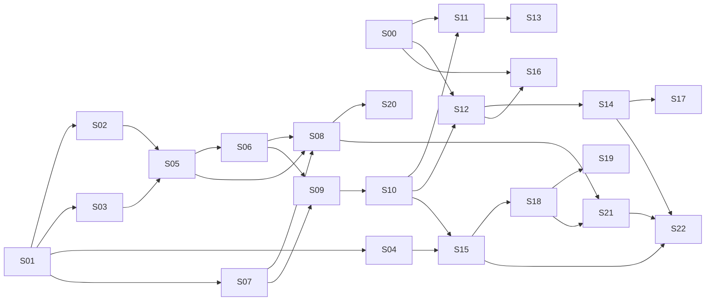

# Slice specs

One spec per vertical slice (S00–S22). A slice ends with tests that pass, merged to `main`, and adds
something later slices can rely on. Build in the order below; slices in the same row can run in
parallel (separate worktrees) once their dependencies are merged.

## Index

| ID | Title | Phase | Depends on | Design sections (docs/design.md) |
|---|---|---|---|---|
| [S00](S00-model-selection-spike.md) | Model selection spike | 0 | — | اختيار النماذج والتقييم › المرشحون / مجموعة التقييم / المقاييس؛ خارطة الطريق › المراحل (0) |
| [S01](S01-foundation.md) | Repo foundation and CI | 1 | — | الرؤية المعمارية › الطبقات؛ البيانات والتشغيل › الـ CI/CD |
| [S02](S02-job-state-machine.md) | Job state machine | 2 | S01 | آلة الحالات والاعتمادية |
| [S03](S03-pipeline-config-and-keys.md) | Pipeline config, deterministic keys, time units | 2 | S01 | تدفق البيانات › مفتاح الـ Idempotency؛ التقسيم والمعالجة المتوازية |
| [S04](S04-arabic-text-normalization.md) | Arabic text normalization | 2 | S01 | خط الأنابيب › 7. المعالجة اللاحقة للعربية |
| [S05](S05-persistence.md) | Schema, repositories, unit of work | 2 | S02, S03 | البيانات والتشغيل › الجداول الأساسية |
| [S06](S06-postgres-job-queue.md) | Postgres job queue, lease, fencing, reconciler | 2 | S05 | تدفق البيانات › لماذا Postgres كطابور؛ آلة الحالات › آليات الاعتمادية |
| [S07](S07-object-storage.md) | Object storage and presigned uploads | 2 | S01 | تدفق البيانات › دورة الطلب؛ الأمان › فحص الملفات |
| [S08](S08-api-auth-jobs.md) | API, auth, job endpoints | 2 | S05, S06, S07 | تدفق البيانات › نقاط النهاية؛ الأمان › الهوية والصلاحيات |
| [S09](S09-ingest-validation.md) | Ingest: probe, hash, dedupe, normalize | 2 | S06, S07 | تدفق البيانات › دورة الطلب؛ الأمان › فحص الملفات وعزل FFmpeg؛ خط الأنابيب › 1 |
| [S10](S10-chunking-fanout-merge.md) | Chunk plan, fan-out, merge (Fake ASR, end-to-end) | 2 | S09 | خط الأنابيب › التقسيم والمعالجة المتوازية والتجميع |
| [S11](S11-vad-cut-merge.md) | VAD with cut and merge | 3 | S10, S00 | خط الأنابيب › 2. VAD مع Cut & Merge |
| [S12](S12-asr-adapters.md) | ASR adapters via vLLM + hallucination filter | 3 | S10, S00 | الـ Ports؛ Adapters المخططة؛ خط الأنابيب › 3، 4؛ تشغيل الـ GPU Worker |
| [S13](S13-audio-profiling-routing.md) | Audio profiling and routing | 3 | S11 | خط الأنابيب › 1.5 تحليل الصوت والتوجيه |
| [S14](S14-forced-alignment.md) | Forced alignment | 4 | S12 | خط الأنابيب › 5. Forced Alignment |
| [S15](S15-canonical-transcript-renderers.md) | Canonical transcript and renderers | 4 | S04, S10 | نواتج النظام › التمثيل المرجعي / الصيغ المشتقة / الترجمات المرئية |
| [S16](S16-evaluation-harness.md) | Evaluation harness, robustness matrix, CI gate | 4 | S00, S12 | اختيار النماذج والتقييم (كامل) |
| [S17](S17-diarization.md) | Speaker diarization | 5 | S14 | خط الأنابيب › 6. Speaker Diarization |
| [S18](S18-rag-indexing-search.md) | RAG chunks, embeddings, hybrid search | 5 | S15 | نواتج النظام › الـ RAG |
| [S19](S19-enrichment.md) | Enrichment (chapters, summaries, entities) | 5 | S18 | نواتج النظام › الإثراء |
| [S20](S20-outbox-webhooks-observability.md) | Outbox, webhooks, observability | 5 | S08 | نقاط النهاية؛ البيانات والتشغيل › المراقبة |
| [S21](S21-privacy-retention-deletion.md) | Privacy, retention, deletion | 5 | S08, S18 | الأمان › الخصوصية ودورة حياة البيانات |
| [S22](S22-corrections-training-export.md) | Human corrections and training export | 5 | S14, S15, S21 | نواتج النظام › التصحيح البشري وبيانات التدريب |

## Order

Parallel tracks after S01: {S02, S03, S04, S07}. After S10: {S11, S12, S15}. S00 runs alongside S01–S10
(it is notebooks and data, not product code).

## Rules for every spec
- Generated with `/extract-spec SXX`, reviewed by `spec-reviewer`, approved by a human.
- Open questions answered before `/implement-slice SXX`.
- If implementation proves the spec wrong: stop, update the spec in a `docs(SXX): ...` commit on the
  same branch, say why in the commit body.
- Numbers marked *(initial)* come from the design doc's "حدود التشغيل المبدئية" or similar and are
  configuration, not constants.
